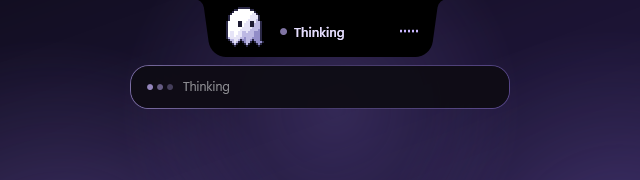

<p align="center">
  
</p>

<h1 align="center">GhostyNav</h1>

<p align="center">
  <b>A notch for your Windows desktop, with a little ghost who listens.</b><br>
  Media, controls and widgets that drop down from the top of your screen,
  and a voice assistant you can talk to while you point at things.
</p>

<p align="center">
  <a href="https://github.com/TheCidSama/GhostyNav/releases/latest/download/GhostyNav-Setup.exe"></a>
</p>

<p align="center">
  <a href="https://github.com/TheCidSama/GhostyNav/releases/latest"></a>
  <a href="LICENSE"></a>
  
  
  
</p>

<p align="center">
  
</p>

---

GhostyNav puts a small black notch at the top centre of your screen, flush with the edge like a
MacBook's. Click it and it springs open into a panel of tabs. Hover it while music plays and a mini
player drops down. Hold <kbd>Ctrl</kbd>+<kbd>Alt</kbd> and a pixel-art ghost listens, looks at whatever
you circle on screen, and gets things done. All of that in about 27 MB of memory.

## Highlights

- **Talk to it.** Hold <kbd>Ctrl</kbd>+<kbd>Alt</kbd>, speak, let go. It opens apps, searches YouTube and
  the web, answers questions and sets up reminders, out loud if you like.
- **Point at things.** Circle anything on screen with a neon trail and ask about it.
- **Control centre.** Wi-Fi, Bluetooth, sound output, Night Light, dark mode and volume, one click away.
- **Now playing.** Album art, a glow in the colours of the cover and a wavy timeline you can drag,
  from Spotify or any media app.
- **Your day.** Clock, weather, the week ahead, a timer and a to-do list.
- **System stats.** Live CPU, GPU and RAM gauges, the busiest apps and an internet speed test.
- **Clipboard history.** Text, links, images and files, pasted back with <kbd>Enter</kbd>.
- **App launcher.** Fuzzy search over everything in your Start menu.
- **Light.** About 27 MB of memory and no CPU to speak of while it waits.

## Install

1. Download **[GhostyNav-Setup.exe](https://github.com/TheCidSama/GhostyNav/releases/latest/download/GhostyNav-Setup.exe)**
   (6.4 MB) from the [latest release](https://github.com/TheCidSama/GhostyNav/releases/latest).
2. Run it and click **Install**. Setup:
   - installs GhostyNav just for you, with no admin rights needed
   - adds it to the Start menu and to your **PATH**, so typing `ghostynav` in any new terminal starts it
   - can start it when you sign in and add a desktop shortcut, if you leave those boxes ticked
   - gets the free **.NET 10 Desktop Runtime** from Microsoft if your PC doesn't have it yet
     (Windows asks for permission once)
3. Click **Open GhostyNav**. The notch appears at the top of your screen.

The installer isn't code-signed yet, so Windows SmartScreen may say it protected your PC. Click
**More info**, then **Run anyway**.

To **update**, run the newer Setup; your settings stay. To **uninstall**, go to **Settings › Apps ›
Installed apps › GhostyNav › Uninstall**. It removes the app, its shortcuts and its PATH entry, and
only deletes your settings if you ask it to.

<details>
<summary>Installing from a script</summary>

| Command | Does |
| --- | --- |
| `GhostyNav-Setup.exe /quiet` | Installs without a window, with the default choices |
| `/nostartup`, `/nopath`, `/desktop`, `/launch` | Added after `/quiet`: don't start at sign-in, don't add to PATH, add a desktop shortcut, open it when done |
| `"%LOCALAPPDATA%\Programs\GhostyNav\uninstall.exe" /quiet` | Uninstalls without a window (add `/purge` to delete settings too) |

</details>

**You'll need** 64-bit Windows 11, or Windows 10 version 2004 or later. For the assistant, a
microphone and a free Gemini API key.

### Add your Gemini key

1. Get a free key from [Google AI Studio](https://aistudio.google.com/apikey).
2. Click the notch, tap the gear tile in **Controls**, paste the key and press **Save**. GhostyNav
   checks that it works without using any of your quota.
3. Hold <kbd>Ctrl</kbd>+<kbd>Alt</kbd> and say hello.

## Meet Ghosty

The ghost lives in the notch and shows you what it's doing.

<table>
  <tr>
    <td align="center"><br><sub><b>Listening</b><br>mouths along as you talk</sub></td>
    <td align="center"><br><sub><b>Thinking</b><br>glances around while Gemini works</sub></td>
    <td align="center"><br><sub><b>Done</b><br>throws its arms up</sub></td>
    <td align="center"><br><sub><b>Oops</b><br>when something didn't work</sub></td>
  </tr>
</table>

It blinks, its hem ripples, and it reads its replies aloud in a female or male voice if you want it to.

## The voice assistant

1. **Hold <kbd>Ctrl</kbd>+<kbd>Alt</kbd>.** The notch drops down, the ghost starts listening and a soft
   blue glow rises along the edges of your screen, brightening with your voice. Your words appear
   under the notch as you say them.
2. **Point if you like.** While you hold the keys, your cursor leaves a neon lavender trail. Loop it
   around anything on screen (a word, an error message, a photo, a chart) and that area goes along
   with your question.
3. **Let go.** GhostyNav does what you asked, or answers in a card that tidies itself away after a
   few seconds.

| You say | GhostyNav |
| --- | --- |
| "Open Spotify" | opens the app |
| "Search YouTube for lo-fi beats" | opens YouTube results in your browser |
| "Look up train times to Kyoto" | searches the web |
| "Open github.com" | opens the site |
| *(circle a word)* "What does this mean?" | explains it in a sentence or three |
| *(circle an error)* "How do I fix this?" | tells you, using what it sees |
| "Remind me to stretch every day at 3" | sets up a reminder |
| "Open Spotify every weekday at 9" | sets up a routine that runs on its own |
| "What routines do I have?" / "Delete the stretch one" | reads or changes your routines |

**Circled something but not sure what to ask?** Let go without speaking. The area stays highlighted
and the ghost waits; hold <kbd>Ctrl</kbd>+<kbd>Alt</kbd> again within a minute and say what you want.

**Routines** are reminders and actions the assistant schedules for you: once, every day, on weekdays,
on chosen days, or every few minutes. Reminders drop down from the notch; actions just happen. You
can see and delete every routine in Settings.

## The notch

Click the notch to open it. It resizes to fit each tab, and you can switch tabs by clicking, by
dragging sideways, with a two-finger swipe, with the mouse wheel or from the keyboard.

| Tab | What's in it |
| --- | --- |
| **Controls** | Wi-Fi, Bluetooth, sound output, Night Light, dark mode and volume, plus the now-playing card glowing in the colours of the cover, with a wavy timeline you can drag. Offers to open Spotify when nothing is playing. The gear tile opens **Settings**: your Gemini key, the listening glow, the voice and your routines. |
| **Today** | A big clock, the weather, the week at a glance, a timer with quick presets and a to-do list that splashes green when you tick things off. |
| **Stats** | CPU, GPU and RAM gauges that fill up as you open the tab, disk, network, uptime, the apps using the most, and a speed test whose numbers count up live. |
| **Clipboard** | Your clipboard history (text, links, images and files) with search, filters and pins. <kbd>Enter</kbd> pastes straight into the app you were using. |
| **Apps** | Every app in your Start menu with its icon, fuzzy search, favourites and recents, and a web search when nothing matches. |
| **Power** | Lock, sleep, restart and shut down. Restart and shut down ask for a second click. |

Closed, the notch still keeps you company:

- **Now playing:** album art and dancing bars in the colours of the cover.
- **Mini player:** hover the notch, or skip a track, and a player drops down.
- **Timer:** a running countdown shows in the notch.
- **Reminders:** routines drop down when they're due.
- **Out of the way:** it steps aside for fullscreen games and videos, and stays out of Alt+Tab and the taskbar.

Right-click the notch to turn **Start with Windows** on or off, or to exit.

## Shortcuts

| Keys | Does |
| --- | --- |
| Hold <kbd>Ctrl</kbd>+<kbd>Alt</kbd> | Talk to the assistant (circle things with the mouse while you hold) |
| <kbd>Ctrl</kbd>+<kbd>Alt</kbd>+<kbd>Space</kbd> | Open Apps and start typing |
| <kbd>Ctrl</kbd>+<kbd>Alt</kbd>+<kbd>V</kbd> | Open the clipboard history |
| <kbd>Ctrl</kbd>+<kbd>1</kbd> ... <kbd>Ctrl</kbd>+<kbd>6</kbd> | Jump to a tab |
| <kbd>Ctrl</kbd>+<kbd>7</kbd> | Open Settings |
| <kbd>Ctrl</kbd>+<kbd>Tab</kbd>, <kbd>←</kbd> <kbd>→</kbd> | Next or previous tab |
| <kbd>Esc</kbd> | Close the notch |
| In Clipboard: <kbd>↑</kbd> <kbd>↓</kbd>, <kbd>Enter</kbd>, <kbd>Ctrl</kbd>+<kbd>C</kbd>, <kbd>Ctrl</kbd>+<kbd>P</kbd>, <kbd>Del</kbd> | Move, paste, copy, pin, remove |

## Light on your PC

| What GhostyNav is doing | Memory | CPU |
|---|---|---|
| Closed, waiting at the top of the screen | **27 MB** | 0.07 % |
| Open, moving between all seven pages | 45 to 58 MB | under 0.5 % with the live Stats gauges |
| Closed again after opening every page | 50 MB | 0.00 % |

<sub>Measured on Windows 11 with a Ryzen 5 8600G. Memory is the figure in Task Manager's Memory
column; CPU is the share of the whole machine.</sub>

Pages are only built the first time you open them, nothing is redrawn while the notch is idle, and
stats only update while you're looking at them.

## Privacy

No accounts, no analytics, no telemetry. This is everything that leaves your PC:

| When | Sent to | What |
| --- | --- | --- |
| While you hold <kbd>Ctrl</kbd>+<kbd>Alt</kbd> | Google Gemini | Your voice, for live transcription |
| When you let go after speaking | Google Gemini | What you said, any areas you circled, the time, your routines and the names of your apps |
| When you click the weather | Open-Meteo | Your approximate location |
| When you run the speed test | Cloudflare | Test data only |

The microphone is only on while you hold the keys, and if you let go without speaking, no question
or circled area is sent. Your API key and location are encrypted on your PC with Windows' own
protection. Clipboard history stays on your PC too, as plain files you can clear from the Clipboard
tab; copies that password managers mark as private are never saved. The assistant opens apps and
links without asking first, so keep an eye on what you circle.

## Build from source

With the [.NET 10 SDK](https://dotnet.microsoft.com/download/dotnet/10.0):

```powershell
git clone https://github.com/TheCidSama/GhostyNav.git
cd GhostyNav
dotnet run -c Release
```

To build the installer, run `powershell -ExecutionPolicy Bypass -File installer\build.ps1`. It
writes `publish\GhostyNav-Setup.exe`.

Issues and pull requests are welcome. Please keep GhostyNav light: no heavy dependencies, and nothing
that runs or redraws while the notch is idle.

## License

GhostyNav is released under the [MIT License](LICENSE).

The Night Light toggle uses the registry format worked out by
[nightlight-cli](https://github.com/nathanbabcock/nightlight-cli), and weather comes from
[Open-Meteo](https://open-meteo.com/). GhostyNav is an independent project and isn't affiliated with
Apple, Google, Microsoft or Spotify.
